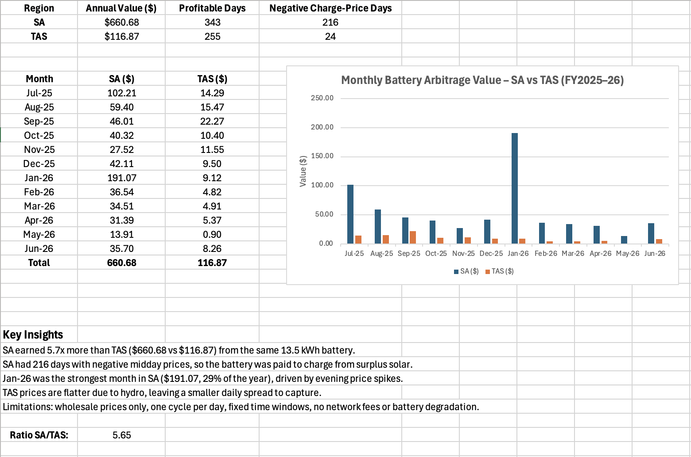
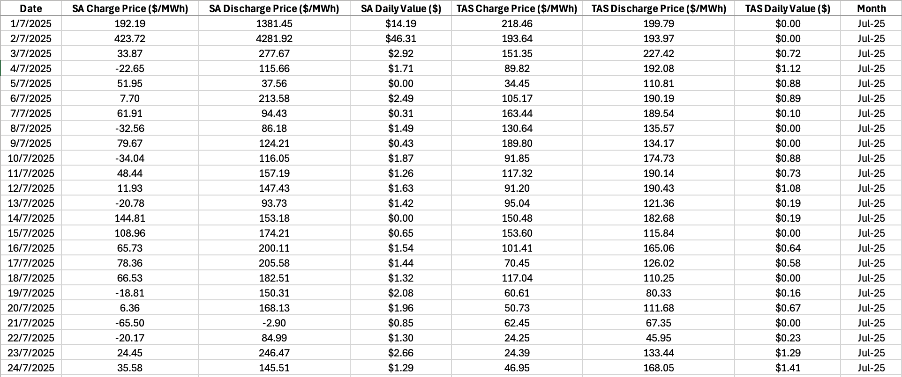

# Home Battery Arbitrage Model – SA vs TAS (FY2025–26)

An Excel model estimating how much a 13.5 kWh home battery could earn by charging when wholesale electricity prices are low (midday) and discharging when they are high (evening), using real AEMO five-minute price data for South Australia and Tasmania.

## Business Question

How much value could a home battery capture from daily wholesale price movements, and how does this differ between South Australia and Tasmania?

## Key Results

| Region | Annual Value | Profitable Days | Negative Charge-Price Days |
|---|---|---|---|
| SA | $660.68 | 343 | 216 |
| TAS | $116.87 | 255 | 24 |

- SA earned **5.7x** more than TAS from the same battery.
- SA had **216 days** with negative midday prices, when surplus rooftop solar meant the battery was effectively paid to charge.
- **January 2026** was SA's strongest month ($191.07, 29% of the annual value), driven by evening price spikes.
- TAS prices are flatter due to hydro generation, leaving a smaller daily price spread to capture.

## How the Model Works

| Sheet | Purpose |
|---|---|
| Battery_Inputs | Adjustable assumptions: battery size, round-trip efficiency, charge and discharge windows |
| Battery_Daily | 365 days × 2 regions: average charge and discharge prices ($/MWh) and daily value ($) |
| Battery_Summary | Annual totals, monthly breakdown, chart and key insights |
| PriceDemand | 210,000+ AEMO five-minute price and demand intervals |

### Model Inputs

| Input | Value |
|---|---|
| Battery size | 13.5 kWh |
| Round-trip efficiency | 90% |
| Charge window | 10:00 – 12:59 |
| Discharge window | 17:00 – 19:59 |

### Calculation

1. **Charge price**: average spot price (RRP) during the charge window each day (AVERAGEIFS)
2. **Discharge price**: average spot price during the discharge window each day (AVERAGEIFS)
3. **Daily value** = MAX(0, kWh × efficiency × discharge price − kWh × charge price) ÷ 1000
4. **Monthly and annual totals**: SUMIFS and SUM; profitable and negative-price days: COUNTIF

The MAX(0, …) rule assumes the battery does not cycle on days when it would lose money.

All assumptions are in one input sheet, so changing the battery size, efficiency or time windows updates the whole model.

## Assumptions and Limitations

- Wholesale spot prices only (no retail tariffs, network charges or feed-in tariffs)
- One full charge and discharge cycle per day, within fixed time windows
- Battery degradation, household consumption and solar self-consumption are not modelled
- Results show the value of the price spread, not a household bill saving

## Tools

Excel: AVERAGEIFS, SUMIFS, COUNTIF, EDATE, structured table references, input-driven modelling, charts

## Data Source

Australian Energy Market Operator (AEMO), aggregated price and demand data, July 2025 – June 2026.
